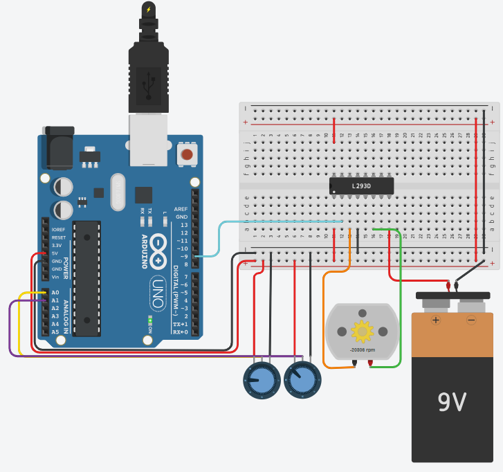

# DC Motor Duty Cycle And Frequency

## Problem statement

Control a DC motor with two potentiometers: one sets the duty cycle (the speed) and the other sets the
PWM frequency. Print the duty cycle and frequency on the Serial Monitor.

## Components

- Arduino Uno R3
- L293D motor driver
- DC motor
- 9V battery
- 2 x 250 kohm potentiometers
- small breadboard

## Connections

| Part | Arduino pin |
|------|-------------|
| Duty cycle potentiometer wiper | A0 |
| Frequency potentiometer wiper | A1 |
| L293D input 1 | 9 |

The potentiometer ends go to 5V and GND. The 9V battery powers the motor through the L293D.

## How it works

`analogWrite()` on pin 9 always runs at about 490 Hz, so the PWM is made in the code instead:
the pin is set HIGH for `onTime` and LOW for the rest of the period with `delayMicroseconds()`.

- duty cycle: 0 - 100 %
- frequency: 100 - 1000 Hz

The potentiometers are read only every 100 ms. Reading them in every cycle made each period longer
than it should be, so the motor ran slower than the duty cycle shown.

## Circuit

