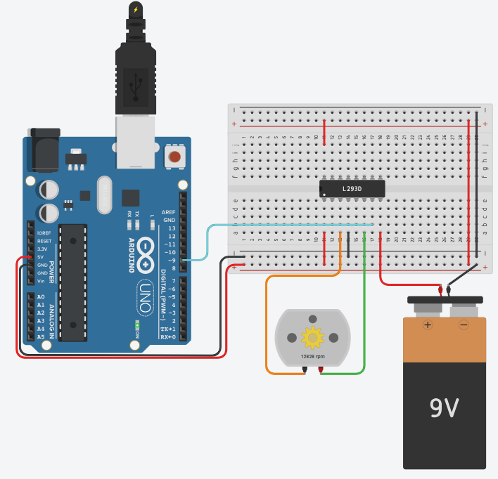

# DC Motor RPM From Serial

## Problem statement

Type a speed in rpm in the Serial Monitor and the DC motor should run at about that speed.
The motor is driven with PWM through an L293D motor driver.

## Components

- Arduino Uno R3
- L293D motor driver
- DC motor
- 9V battery
- small breadboard

## Connections

| Part | Arduino pin |
|------|-------------|
| L293D input 1 | 9 (PWM) |

The 9V battery powers the motor through the L293D.

## How it works

The rpm of the motor is not a straight line of the PWM value, so I wrote down the rpm Tinkercad shows
for a few PWM values (the table at the top of the sketch). For the rpm that is typed, the code finds
the two nearest points in the table and works out the PWM between them.
Anything above the top of the table just gives full speed (PWM 255).

The table was measured on this simulated circuit (9V battery through the L293D), so a real motor
needs its own table.

## Circuit

