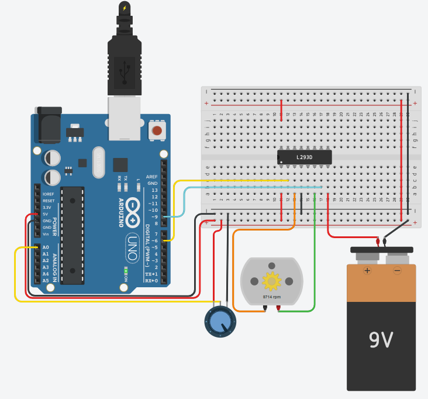

# DC Motor Speed Control

## Problem statement

Control the speed of a DC motor with a potentiometer.
The Arduino reads the potentiometer and drives the motor through an L293D motor driver using PWM.

## Components

- Arduino Uno R3
- L293D motor driver
- DC motor
- 9V battery
- 250 kohm potentiometer
- small breadboard

## Connections

| Part | Arduino pin |
|------|-------------|
| Potentiometer wiper (ends to 5V and GND) | A0 |
| L293D input 1 | 9 (PWM) |
| L293D input 2 | 6 |

The motor is on the L293D outputs 1 and 2. The 9V battery powers the motor side of the L293D and
the Arduino 5V powers the logic side, with the grounds joined.

## How it works

The pot reading (0 - 1023) is mapped to 0 - 255 and written to pin 9 with `analogWrite()`.
Pin 6 stays LOW so the motor always turns the same way. The PWM value is printed on the Serial Monitor.
Turning the knob up makes the rpm shown on the motor go up.

## Circuit

