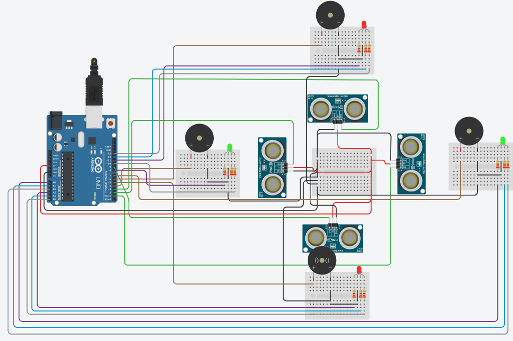

# Four Side Obstacle Warning

## Problem statement

A vehicle needs a warning for obstacles on all four sides. Use four ultrasonic sensors (front, back, left
and right). For each side an RGB LED shows:

- green when the nearest object is 200 cm or more away
- yellow between 75 and 200 cm
- red when it is closer than 75 cm

The buzzer of that side should beep while it is red.

## Components

- Arduino Uno R3
- 4 PING ultrasonic sensors (3 pin)
- 4 RGB LEDs (common cathode)
- 4 piezo buzzers
- 12 x 220 ohm resistors
- 6 mini breadboards

## Connections

| Side | Sensor SIG | Buzzer | LED red | LED green |
|------|------------|--------|---------|-----------|
| Front | 3 | 6 | 11 | 13 |
| Back | 9 | 5 | A3 (17) | A5 (19) |
| Left | 2 | 4 | 8 | 10 |
| Right | 1 | 7 | A0 (14) | A2 (16) |

The blue legs of the LEDs are not used. The sensors take 5V and GND from the middle breadboard.

## How it works

The PING sensor uses one pin for both trigger and echo, so the pin is switched to OUTPUT for the pulse
and back to INPUT for `pulseIn()`. The time is turned into cm with `0.01723 * time`.
Red and green together make yellow. After all four sides are checked, every side that is red gets a
short 1 kHz beep.

Note: the back sensor was first on pin 0. Pin 0 is the RX pin and the USB serial chip is connected to it,
so the echo could not be read and the back side always showed red. It now uses pin 9.
Pin 1 is still used by the right sensor, so this sketch can't use the Serial Monitor.

## Circuit

