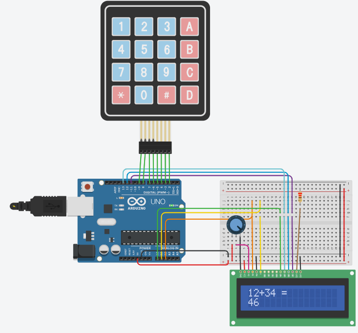

# Keypad LCD Calculator

## Problem statement

Make a simple calculator with a 4x4 keypad and a 16x2 LCD.
The number keys type a number, A, B, C and D pick +, -, x and /, # shows the answer and * clears everything.
The sum goes on the first line of the LCD and the number being typed (or the answer) on the second line.

## Components

- Arduino Uno R3
- 4x4 keypad
- 16x2 LCD
- 250 kohm potentiometer (LCD contrast)
- 220 ohm resistor (LCD backlight)
- small breadboard

## Connections

| Part | Arduino pin |
|------|-------------|
| LCD RS, E | A2, A1 |
| LCD D4, D5, D6, D7 | A0, 13, 12, 11 |
| Keypad rows 1 to 4 | 9, 8, 7, 6 |
| Keypad columns 1 to 4 | 5, 4, 3, 2 |

LCD RW goes to GND and V0 to the potentiometer wiper. The analog pins are used as digital pins
(A0 = 14, A1 = 15, A2 = 16) because the keypad takes most of the digital pins.

## Keys

| Key | Action |
|-----|--------|
| 0 - 9 | type a number (more than one digit is fine) |
| A | + |
| B | - |
| C | x |
| D | / |
| # | = |
| * | clear |

## How it works

Each digit is added to the number with `Number = Number * 10 + digit`.
An operator key saves the number in `Num1` and starts a new one, # saves it in `Num2` and calculates.
Pressing an operator right after an answer carries the answer forward, and a new digit starts a new sum.
Dividing by 0 shows an error. The maths uses `long`, so division gives a whole number.
Every key is also printed on the Serial Monitor.

Needs the Keypad library (Mark Stanley, Alexander Brevig) if you use the Arduino IDE.

## Circuit

