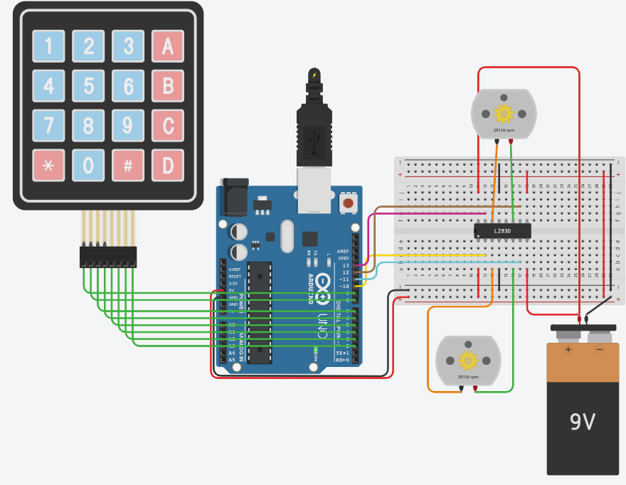

# Keypad Robot Car

## Problem statement

Drive a two wheel robot car with a 4x4 keypad. Both motors run through an L293D motor driver.

| Key | Car |
|-----|-----|
| 2 | forward |
| 8 | back |
| 4 | left |
| 6 | right |
| 0 | stop |

## Components

- Arduino Uno R3
- 4x4 keypad
- L293D motor driver
- 2 DC motors
- 9V battery
- small breadboard

## Connections

| Part | Arduino pin |
|------|-------------|
| Keypad rows 1 to 4 | 9, 8, 7, 6 |
| Keypad columns 1 to 4 | 5, 4, 3, 2 |
| Left motor forward, back (L293D inputs) | 11, 10 |
| Right motor forward, back (L293D inputs) | 12, 13 |

The 9V battery powers the motors through the L293D.

## How it works

`kpd.getKey()` gives the key that was pressed and `drive()` sets the four L293D inputs.
For forward both motors turn forward, for back both turn backwards.
To turn left only the right motor runs, to turn right only the left motor runs.
The car keeps doing the last command until another key is pressed.

Needs the Keypad library (Mark Stanley, Alexander Brevig) if you use the Arduino IDE.

## Circuit

