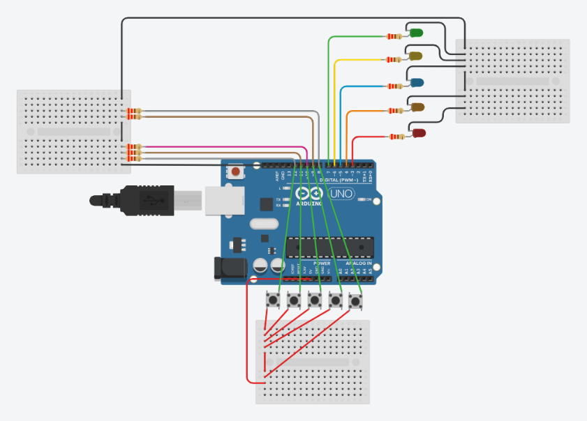

# LED Bar With Push Buttons

## Problem statement

Connect 5 push buttons and 5 LEDs to an Arduino. Pressing button 1 should light only the first LED,
button 2 the first two LEDs, and so on, so that button 5 lights all five (like a level indicator).
If more than one button is pressed, the highest one decides.

## Components

- Arduino Uno R3
- 5 push buttons
- 5 LEDs (green, yellow, blue, orange, red)
- 10 x 220 ohm resistors
- 3 mini breadboards

## Connections

| Part | Arduino pin |
|------|-------------|
| Buttons 1 to 5 | 12, 11, 10, 9, 8 |
| Green, yellow, blue, orange, red LED | 7, 6, 5, 4, 3 |

- One side of every button goes to 5V, the other side to its pin and to GND through a 220 ohm pull-down resistor.
- Each LED goes from its pin through a 220 ohm resistor to GND.

## How it works

The loop checks all five buttons and remembers the highest one that is pressed (`level`).
Then the first `level` LEDs are switched on and the rest are switched off.

## Circuit

