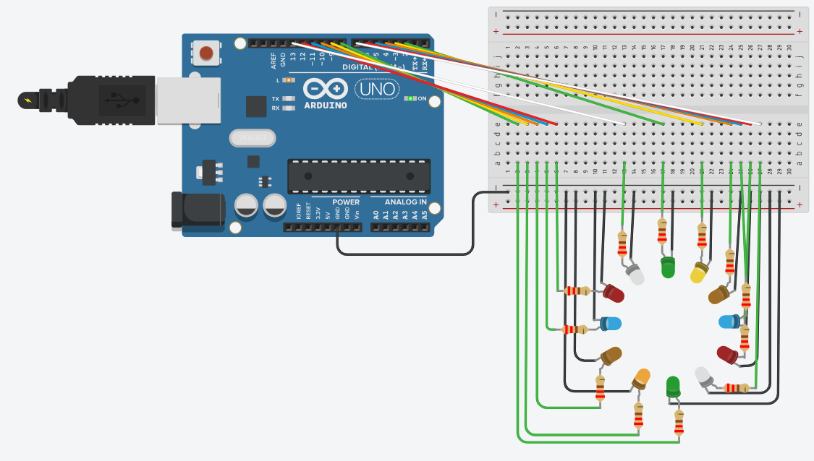

# LED Ring Patterns

## Problem statement

Arrange 12 LEDs in a ring and connect them to pins 2 to 13.
The user types a number in the Serial Monitor to choose a light pattern:

- 1: one LED runs around the ring
- 2: the same but in the other direction
- 3: all LEDs blink 5 times
- 4: odd and even LEDs blink in turn, 5 times

## Components

- Arduino Uno R3
- 12 LEDs (2 green, 1 yellow, 3 orange, 2 blue, 2 red, 2 white)
- 12 x 220 ohm resistors
- small breadboard

## Connections

| Part | Arduino pin |
|------|-------------|
| LEDs 1 to 12 (around the ring) | 2 to 13 |

Each LED goes from its pin through a 220 ohm resistor to GND.

## How it works

`Serial.parseInt()` reads the number typed in the Serial Monitor and a `switch` runs the pattern.
The chase patterns use a `for` loop over the pins with 200 ms per LED, the blink patterns use 500 ms on and off.

## Circuit

