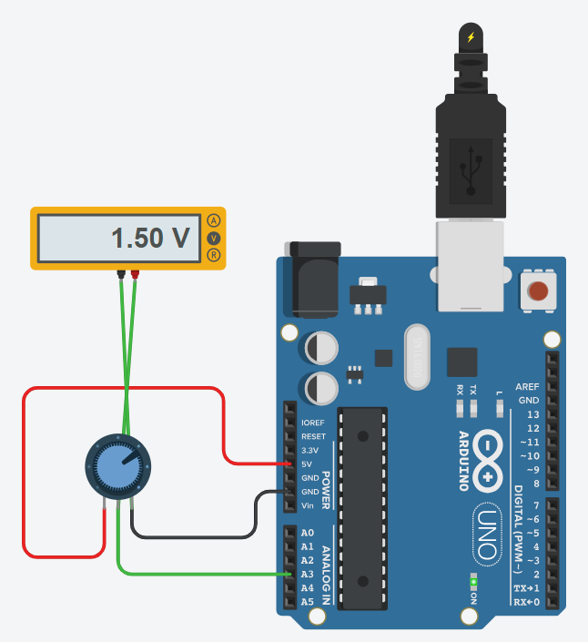

# Potentiometer Voltage

## Problem statement

Read the voltage at the middle pin (wiper) of a potentiometer with an analog pin.
Convert the 0 - 1023 reading into volts, print it on the Serial Monitor and check it with a multimeter.

## Components

- Arduino Uno R3
- 250 kohm potentiometer
- multimeter (voltage mode)

## Connections

| Part | Arduino pin |
|------|-------------|
| Potentiometer ends | 5V and GND |
| Potentiometer wiper | A3 |
| Multimeter | across the wiper and GND |

## How it works

`analogRead(A3)` gives 0 to 1023 for 0 to 5 V, so the voltage is `value * 5.0 / 1023.0`.
Both the raw value and the voltage are printed every 500 ms.
In the simulation the Serial Monitor and the multimeter show the same voltage (1.50 V for the knob
position in the picture).

## Circuit

