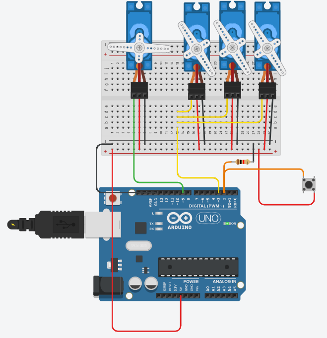

# Servo Group With One Button

## Problem statement

Same servos as the two button version (three servos on one pin, one on its own), but with a single button.
Every press moves both to the next pair of positions:

| Press | Group of 3 | Single servo |
|-------|------------|--------------|
| start | 0 | 0 |
| 1 | 120 | 20 |
| 2 | 30 | 90 |
| 3 | back to 0 | back to 0 |

## Components

- Arduino Uno R3
- 4 micro servos
- 1 push button
- 1 kohm resistor
- small breadboard

## Connections

| Part | Arduino pin |
|------|-------------|
| Signal of the 3 grouped servos | 3 |
| Signal of the single servo | 9 |
| Button | 2 |

The button goes between 5V and pin 2, with a 1 kohm pull-down from pin 2 to GND.

## How it works

A press is counted only when the button goes from LOW to HIGH. The count (0, 1, 2) picks the angles from
two arrays and is printed on the Serial Monitor.

## Circuit

