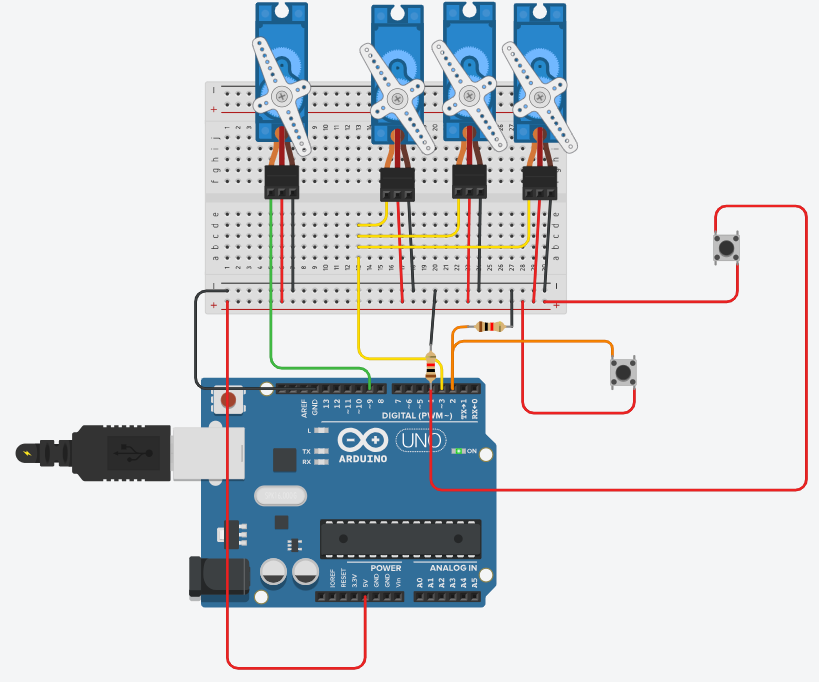

# Servo Group With Two Buttons

## Problem statement

Three servos share one signal pin and move together, a fourth servo has its own pin.
Every press of button 1 moves the group to its next position (0, 120, 30 and back to 0 degrees).
Every press of button 2 moves the single servo to its next position (0, 20, 90 and back to 0 degrees).
Holding a button down should count as one press only.

## Components

- Arduino Uno R3
- 4 micro servos
- 2 push buttons
- 2 x 1 kohm resistors
- small breadboard

## Connections

| Part | Arduino pin |
|------|-------------|
| Signal of the 3 grouped servos | 3 |
| Signal of the single servo | 9 |
| Button 1 (group) | 2 |
| Button 2 (single servo) | 4 |

Each button goes between 5V and its pin, with a 1 kohm pull-down from the pin to GND.
The servos take 5V and GND from the breadboard rails.

## How it works

Each button's last state is saved, and a press is counted only when the button goes from LOW to HIGH.
The count goes 0, 1, 2 and wraps back to 0 (`% 3`), and picks the angle from an array.
The new angle is printed on the Serial Monitor.

## Circuit

