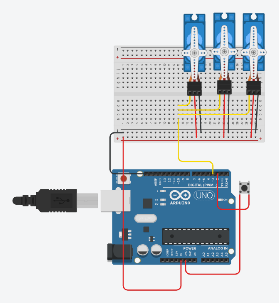

# Servo Sweep With A Push Button

## Problem statement

Three servo motors are driven from one signal pin so they always move together.
When the push button is pressed the servos should turn slowly from 0 to 90 degrees in 10 degree steps.
On the next press they should come back from 90 to 0 degrees.

## Components

- Arduino Uno R3
- 3 micro servos
- 1 push button
- small breadboard

## Connections

| Part | Arduino pin |
|------|-------------|
| Signal wire of all 3 servos | 3 |
| Push button | 2 (other side to GND) |
| Servo power | 5V and GND through the breadboard rails |

The button uses the internal pull-up (`INPUT_PULLUP`), so it reads LOW when pressed and no resistor is needed.

## How it works

A press sets `buttonPushed`. While it is set, the angle changes by 10 degrees every 100 ms.
When the angle reaches 90 or 0 the step is reversed and `buttonPushed` is cleared, so the servos
stop and wait for the next press. The angle is also printed on the Serial Monitor.

## Circuit

