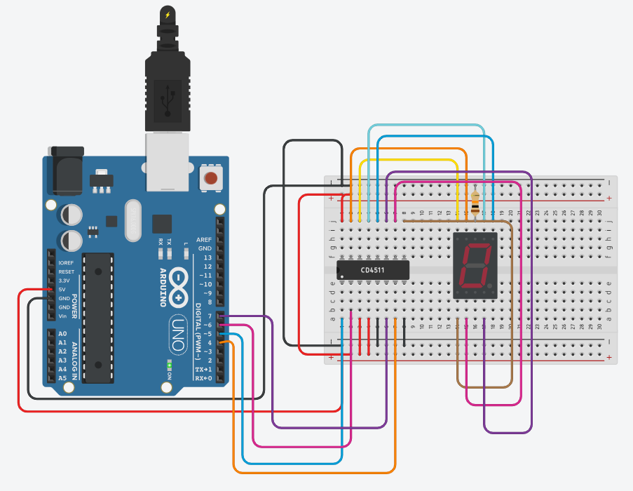

# 7 Segment Counter With CD4511

## Problem statement

Show the digits 0 to 9 on a 7 segment display using a CD4511 BCD to 7 segment decoder, so the Arduino
needs only 4 pins instead of 7. Each digit stays for one second, then the display goes blank for a second
and the count starts again.

## Components

- Arduino Uno R3
- CD4511 BCD to 7 segment decoder
- common cathode 7 segment display
- 10 kohm resistor
- small breadboard

## Connections

| Part | Arduino pin |
|------|-------------|
| CD4511 input A | 4 |
| CD4511 input B | 5 |
| CD4511 input C | 6 |
| CD4511 input D | 7 |

The CD4511 outputs a to g go to the matching segments of the display.

## How it works

The number is sent to the decoder in binary (BCD). `bitRead(n, 0)` to `bitRead(n, 3)` give the four bits
for inputs A to D. The CD4511 shows nothing for values above 9, so sending 15 blanks the display.

## Circuit

