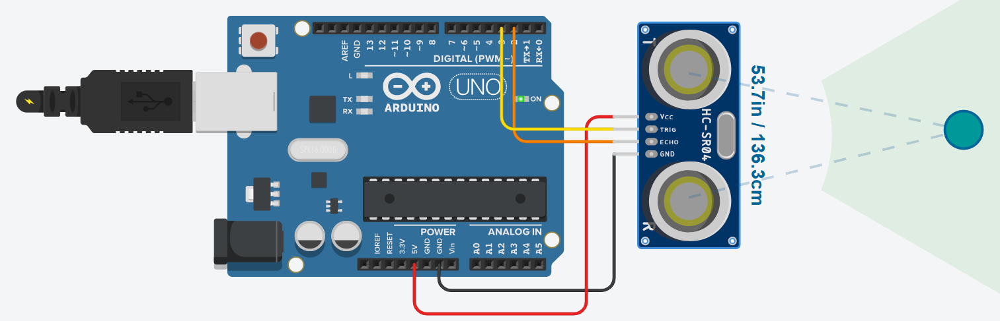

# Ultrasonic Object Detector

## Problem statement

Use the HC-SR04 ultrasonic sensor like a simple obstacle sensor with a digital output:
print 0 on the Serial Monitor when an object is 3 cm or closer and 1 when nothing is that close.

## Components

- Arduino Uno R3
- HC-SR04 ultrasonic distance sensor

## Connections

| Sensor pin | Arduino pin |
|------------|-------------|
| VCC | 5V |
| TRIG | 3 |
| ECHO | 2 |
| GND | GND |

## How it works

A 10 us pulse on TRIG sends the sound burst and `pulseIn()` measures how long ECHO stays HIGH.
Sound travels about 0.034 cm per microsecond and the time is for going and coming back,
so `distance = duration * 0.034 / 2`. The result is checked against 3 cm every 100 ms.

In Tinkercad, click the sensor while the simulation runs and drag the round target to change the distance.

## Circuit

